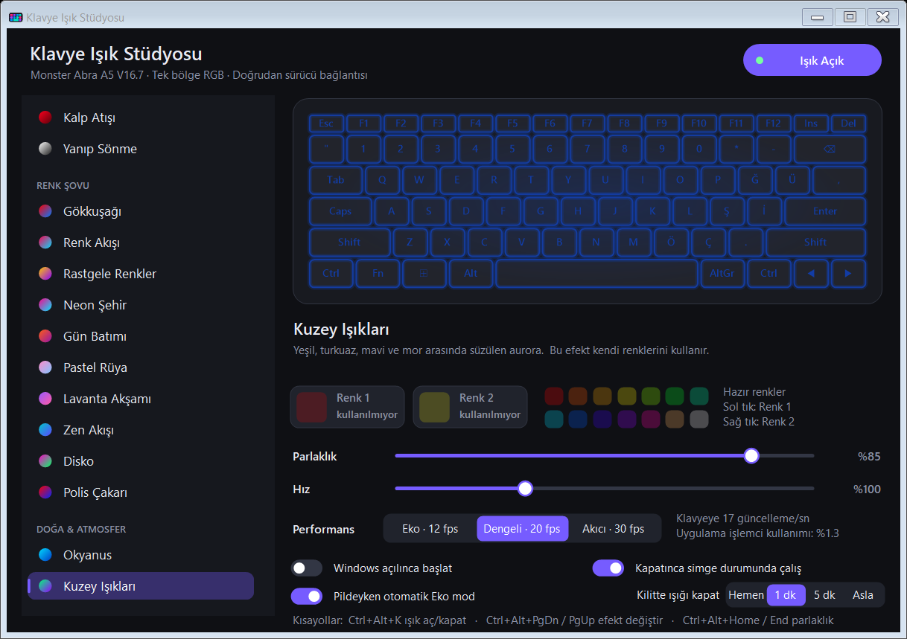

# Klavye Işık Stüdyosu

Clevo tabanlı **Monster** dizüstülerin **tek bölge RGB** klavye ışığı için hafif, Türkçe bir kontrol programı.
35 efekt (müzik, ekran rengi, yazma tepkisi, doğa efektleri…), düşük işlemci kullanımı, tek dosya, kurulum gerektirmez.

> Resmî bir Monster / Clevo ürünü değildir; bağımsız, açık kaynaklı bir projedir.



**[⬇️ İndir (Releases)](../../releases/latest)** · [Windows engelliyorsa ne yapmalı?](#windows-programı-engelliyorsa)

## Windows programı engelliyorsa

Program **imzasız** olduğu için (dijital imza sertifikası ücretli) Windows ilk açılışta onu tanımaz ve engelleyebilir.
Bu bir virüs uyarısı değildir; kaynak kodun tamamı bu sayfada açıktır. Karşına hangi mesaj çıktıysa ona göre:

**1. Mavi ekran: "Windows kişisel bilgisayarınızı korudu"** (en sık görülen)

1. Yazının altındaki **"Ek bilgi"** bağlantısına tıkla.
2. Çıkan **"Yine de çalıştır"** düğmesine bas. Bunu bir kez yapman yeterli.

**2. "Yine de çalıştır" düğmesi yoksa ya da program hiç açılmıyorsa**

Dosyanın "internetten indirildi" işaretini kaldır:

1. Çıkarttığın klasörü sil.
2. İndirdiğin **zip dosyasına** sağ tıkla → **Özellikler**.
3. En alttaki **"Engellemeyi kaldır"** kutusunu işaretle → **Tamam**.
4. Zip'i yeniden çıkart ve `KlavyeIsik.exe`'yi aç.

**3. "Tehdit bulundu" bildirimi geldiyse ya da `KlavyeIsik.exe` kaybolduysa**

Windows Defender dosyayı yanlışlıkla karantinaya almıştır:

1. **Başlat** → **Windows Güvenliği** → **Virüs ve tehdit koruması** → **Koruma geçmişi**.
2. KlavyeIsik ile ilgili kaydı aç → **Eylemler** → **Geri yükle** (ya da **Cihazda izin ver**).
3. Tekrar olmasın diye: **Virüs ve tehdit koruması** → **Ayarları yönet** → **Dışlamalar** →
   **Dışlama ekle veya kaldır** → **Dışlama ekle** → **Klasör** → programın klasörünü seç.

**4. "Akıllı Uygulama Denetimi bu uygulamayı engelledi" yazıyorsa** (Windows 11)

1. Önce 2. adımı ("Engellemeyi kaldır") dene.
2. Yine engellenirse: **Windows Güvenliği** → **Uygulama ve tarayıcı denetimi** → **Akıllı Uygulama Denetimi ayarları** → **Kapalı**.
   ⚠️ Bazı Windows sürümlerinde bu ayar kapatıldıktan sonra Windows yeniden kurulmadan tekrar açılamaz; son çare olarak kullan.

> Defender'ı tamamen kapatma; izni sadece bu programın klasörüne ver.
> Dosyanın sağlamlığından emin olmak istersen zip'i [VirusTotal](https://www.virustotal.com)'a yükleyip taratabilir
> ya da programı bu sayfadaki kaynak koddan kendin derleyebilirsin.

## Özellikler

- **35 efekt**, 5 grupta:
  - **Temel:** Sabit, Nefes, İki Renk, Kalp Atışı, Yanıp Sönme
  - **Renk Şovu:** Gökkuşağı, Renk Akışı, Neon, Gün Batımı, Pastel Rüya, Lavanta Akşamı, Zen Akışı, Disko, Polis Çakarı…
  - **Doğa & Atmosfer:** Okyanus, Kuzey Işıkları, Lav, Mum, Ateş, Fırtına, Matrix, Galaksi
  - **Etkileşimli:** yazınca parlayan efektler, müziğe göre yanan efektler (ses kaydı yapmaz, sadece çıkış seviyesini okur), **ekran rengi** ve **ekranın alt kısmına göre ambiyans**
  - **Sistem:** işlemci yükü, pil durumu, gün döngüsü
- İki renk seçimi, parlaklık, hız; 14 hazır renk
- **Performans modları:** Eko (12 fps) / Dengeli (20 fps) / Akıcı (30 fps); pildeyken otomatik Eko
- Renk değişmediyse klavyeye hiçbir şey gönderilmez; sabit efektlerde program tamamen uyur
- Kilitlenince ışığı kapatma: Hemen / 1 dk / 5 dk / Asla
- Bildirim alanında (saatin yanında) çalışır, Windows açılınca başlayabilir
- Kısayollar: `Ctrl+Alt+K` aç/kapat · `Ctrl+Alt+PgDn/PgUp` efekt · `Ctrl+Alt+Home/End` parlaklık

Tipik kullanım: animasyonlu efektlerde ~%0,1–0,5 işlemci, ~10–15 MB bellek (tepsideyken).

## Uyumlu modeller

Program açıldığında klavye türünü BIOS'tan **kendisi okur** ve üst satırda gösterir
(örn. `Monster Abra A5 V16.7 · Tek bölge RGB · Doğrudan sürücü bağlantısı`).
Aşağıdaki liste Monster'ın ürün sayfalarındaki klavye bilgisine ve forum kaynaklarına dayanır.

### Tek bölge RGB (desteklenen)

| Model | Kasa (Clevo) | Durum |
|---|---|---|
| Abra A5 V16.7 | NH5x/NH7x | ✅ Test edildi |
| Abra A5 V16.6, V16.8 | NH58DEQ / NH5x | Uyumlu olması beklenir |
| Abra A5 V17.x (V17.2, V17.4…) | NH58HKQ / NH58HPQ | Uyumlu olması beklenir |
| Abra A5 V20.x / V21.x / V22.x | Clevo | Uyumlu olması beklenir |
| Abra A7 V12.x, V13.x | NH79DEQ / NH77DCQ | Uyumlu olması beklenir |
| Abra A7 V15.x, V16.x | Clevo | Uyumlu olması beklenir |
| Tulpar T5 V23.x, Tulpar T6 V3.x | Clevo (muhtemel) | Uyumlu olması beklenir |

Monster'ın sitesinde "**RGB Tek Bölge**" yazan Clevo tabanlı modellerin hepsinde çalışması beklenir.
Kendi modelinde denediysen sonucu bir *issue* ile bildirirsen listeyi güncelleriz.

### Diğer klavye türleri

| Tür | Örnek modeller | Durum |
|---|---|---|
| 3 bölge RGB (Clevo) | eski Clevo kasaları | 🟡 Deneysel: üç bölge aynı renge ayarlanır |
| Tongfang (Uniwill) kasalı modeller | Tulpar T7 V20.6, bazı Tulpar T5 V18–V19 ve Abra V11–V15 | ❌ Desteklenmiyor (farklı denetleyici) |
| 4 bölge RGB | Tulpar T7 V21.5, Tulpar T7 V26.x | ❌ Desteklenmiyor / denenmedi |
| Tuş başına RGB | Semruk S7, Semruk S8 | ❌ Desteklenmiyor |
| Tek renk (beyaz) | Huma H4/H5/H7, Markut M7 | ❌ Renk değiştirilemez |

## Kurulum

1. [Releases](../../releases) sayfasından son sürümün zip'ini indir ve **bir klasöre çıkart**.
2. `KlavyeIsik.exe`'yi çalıştır. Kurulum, .NET ya da yönetici izni gerekmez.
3. Bilgisayarda Monster/Clevo **Kontrol Merkezi (Control Center)** sürücüsü kurulu olmalı
   (Fn tuşlarıyla klavye ışığı değişiyorsa genelde kuruludur).

Windows programı engellerse: [Windows programı engelliyorsa](#windows-programı-engelliyorsa) bölümüne bak.

**Eski modeller (Control Center 2.x):** Bu modellerde klavyeye yalnızca yönetici izniyle erişilebilir.
Program bunu algılar; üst satırdaki yazıya tıklayınca yönetici olarak yeniden başlar.

## Nasıl çalışır?

Clevo kasalarında klavye ışığı BIOS'taki tek bir komutla (`0x67`) ayarlanır. Program üç yolu sırayla dener:

| Yol | Ne zaman | Yönetici |
|---|---|---|
| Insyde DCHU sürücüsü (`ACPI\CLV0001`, `_DSM`, IOCTL `0x322400`) | Control Center 3.x ve sonrası (~2019+) | Gerekmez |
| `InsydeDCHU.dll` → `SetDCHU_Data(0x67, …)` | Aynı sürücü, yedek yol | Gerekmez |
| WMI `root\WMI` → `CLEVO_GET.SetKBLED` | Control Center 2.x (~2015–2019) | Gerekir |

- Renk biçimi: `0xF0000000 | B<<16 | R<<8 | G` (3 bölgede `0xF1…`, `0xF2…` de gönderilir).
- Klavye türü: `0x0D` komutunun döndürdüğü tamponun 15. baytı (`0x06` tek bölge, `0x02` 3 bölge, `0x01` beyaz, `0xF3` tuş başına);
  eski makinelerde `0x52` özellik listesi.
- Bu makinelerde donanımın kendi animasyonları çalışmadığı için tüm efektler yazılımla, sadece renk değiştiğinde komut gönderilerek yapılır.

Komut numaraları ve tür kodları için [tuxedo-drivers](https://github.com/tuxedocomputers/tuxedo-drivers)
(`clevo_leds.h`, `clevo_acpi.c`, `clevo_wmi.c`) kaynak kodundan yararlanıldı.

## Gizlilik

- Ses kaydı yapmaz; yalnızca hoparlör çıkışının anlık seviyesini okur.
- Basılan tuşları kaydetmez; yalnızca "bir tuşa basıldı" bilgisini kullanır.
- Ekran görüntüsü saklamaz; ekranı 64×36 piksele küçültüp ortalama rengi hesaplar.
- İnternete bağlanmaz. Ayarlar `%APPDATA%\KlavyeIsik\ayarlar.json` dosyasında durur.

## Kaynaktan derleme

Gereken: [.NET 8 SDK](https://dotnet.microsoft.com/download/dotnet/8.0)

```powershell
dotnet publish -c Release -r win-x64 --self-contained true -p:PublishSingleFile=true -p:EnableCompressionInSingleFile=true -o dist
```

## Lisans

[MIT](LICENSE)

---

### English

Lightweight Windows controller for the **single-zone RGB keyboard backlight** of Clevo-based laptops
(Monster Abra / Tulpar and similar rebrands). 35 software effects (audio-reactive, screen-ambient, typing-reactive…),
very low CPU use, no install, no admin rights on modern models. It talks to the Insyde DCHU driver directly
(command `0x67`), falls back to `InsydeDCHU.dll` and to the legacy `CLEVO_GET` WMI interface, and detects the
keyboard type (single-zone / 3-zone / white / per-key) from the BIOS. Not affiliated with Monster or Clevo. UI is in Turkish.
